# Saber 鸿蒙版 · 使用手册

> 适用版本:`v1.37.1 (137010)` · 适用系统:HarmonyOS NEXT / OpenHarmony
> 应用包名:`com.sabernotes.saber`

Saber 是一款**手写笔记**应用:用笔或手指在纸上写、画、圈,支持分页笔记、多种笔型、
自定义背景纸样,还能通过 Nextcloud 在多台设备之间同步。

---

## 目录

- [Saber 鸿蒙版 · 使用手册](#saber-鸿蒙版--使用手册)
  - [目录](#目录)
  - [一、三分钟上手](#一三分钟上手)
  - [二、主界面](#二主界面)
  - [三、新建笔记 / 导入笔记](#三新建笔记--导入笔记)
    - [3.1 导入笔记的步骤](#31-导入笔记的步骤)
  - [四、笔记编辑器:手写](#四笔记编辑器手写)
    - [4.1 顶部工具栏](#41-顶部工具栏)
    - [4.2 画布与手势](#42-画布与手势)
    - [4.3 底部工具栏:14 个按钮](#43-底部工具栏14-个按钮)
    - [4.4 颜色选择](#44-颜色选择)
    - [4.5 导出](#45-导出)
      - [另存为对话框](#另存为对话框)
    - [4.6 编辑器设置](#46-编辑器设置)
    - [4.7 插入照片](#47-插入照片)
  - [五、白板](#五白板)
  - [六、全部笔记(浏览)](#六全部笔记浏览)
  - [七、文件树](#七文件树)
  - [八、设置](#八设置)
    - [「书写」分组](#书写分组)
    - [「编辑器」分组](#编辑器分组)
    - [「性能」分组](#性能分组)
    - [「高级」分组](#高级分组)
  - [九、Nextcloud 同步](#九nextcloud-同步)
  - [十、鸿蒙上的已知限制(重要)](#十鸿蒙上的已知限制重要)
    - [已经打通的](#已经打通的)
    - [用不了的(按钮已经被藏起来了)](#用不了的按钮已经被藏起来了)
    - [为什么「自定义数据目录」在鸿蒙上做不了](#为什么自定义数据目录在鸿蒙上做不了)
    - [需要手动设置](#需要手动设置)
    - [建议](#建议)
  - [十一、故障排除](#十一故障排除)
  - [附:这套适配是怎么来的](#附这套适配是怎么来的)

---

## 一、三分钟上手

1. 打开 Saber,默认停在**首页**,这里显示最近编辑过的笔记。
2. 点右下角的 <kbd>＋</kbd> 按钮 → 选**新建笔记**,空白笔记立刻就绪。
3. 打开底部的 **「手指绘制」按钮** (见 [4.3](#43-底部工具栏14-个按钮) 第 16 项),然后就能直接用手指在画布上写了。默认情况下手指是用于平移画布的,笔(手写笔)才是书写工具。
4. 顶部标题栏可以直接点着改名字,改成什么都行。
5. 笔记会自动保存,标题左边的小圆点会告诉你保存状态。

> **没装手写笔?** 平板触屏完全够用 —— 打开「手指绘制」后,一根手指就能写;
> 但多指手势(缩放、平移)会被识别成画布操作,建议配合手写笔使用。

---

## 二、主界面

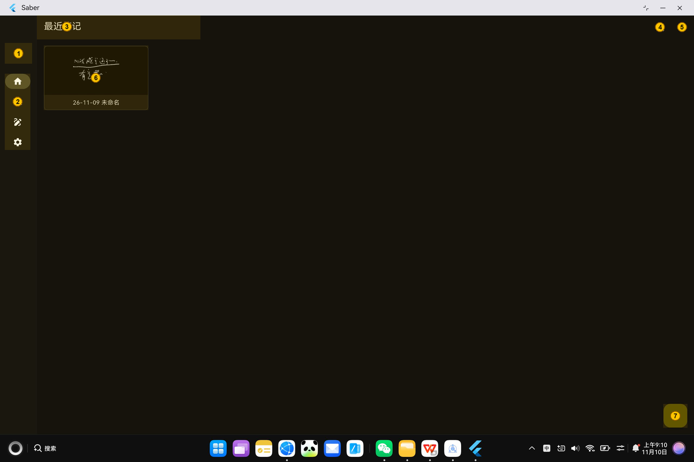

| # | 位置 | 说明 |
|---|---|---|
| 1 | 左上角 `❯` | **展开 / 收起侧边栏**。展开后下方会多出一棵文件树,可以直接按文件夹浏览笔记 |
| 2 | 左侧竖排菜单 | **四个主页面**:首页、全部笔记、白板、设置 |
| 3 | 顶部标题 | 当前页面的名字(最近笔记 / 浏览 / 白板 / 设置) |
| 4 | 标题栏右侧第一个图标 | **切换首页布局**:瀑布流(错落)或简单网格(对齐) |
| 5 | 标题栏右侧第二个图标 | **同步状态**。未登录 Nextcloud 时是灰的,点了没反应 |
| 6 | 笔记卡片 | 一篇笔记的缩略图。点一下直接进编辑器 |
| 7 | 右下角 `＋` | **新建 / 导入笔记**。点开后展开两个选项 |

界面在平板上是「左导航 + 右内容」的双栏布局;在窄窗口(比如分屏)下会自动切换成
底部导航栏。

---

## 三、新建笔记 / 导入笔记

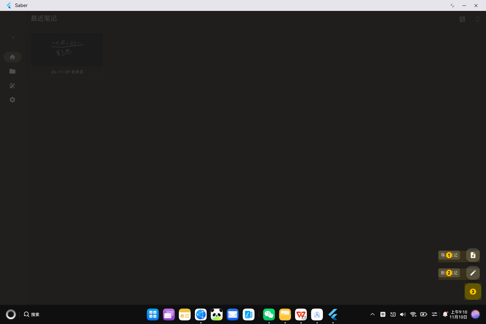

| # | 说明 |
|---|---|
| 1 | **导入笔记** — 从本地文件导入 `.sba`(Saber 笔记文件)。注：导入的笔记没有预览图。另外，鸿蒙暂不支持pdf导入，因为pdf插件暂不支持鸿蒙版。|
| 2 | **新建笔记** — 创建一篇空白笔记 |
| 3 | 再次点击可收起这个菜单 |

新笔记会以**空白页**打开,你可以立刻开始写。

### 3.1 导入笔记的步骤

1. 首页右下角的 **「＋」** → **导入笔记**。
2. 系统会弹出**鸿蒙自带的文件选择器**(和应用里的文件管理器是同一个)。
   左边一竖排是位置(最近 / 桌面 / 文档 / 下载 / 图片 / 华为分享 …),
   上面一排是「新建 / 排序 / 查看 / 预览」,中间是文件列表。
3. 点一下要导入的文件(左下角的「已选」会变成 `1/1`),再点右下角的 **「打开」**。

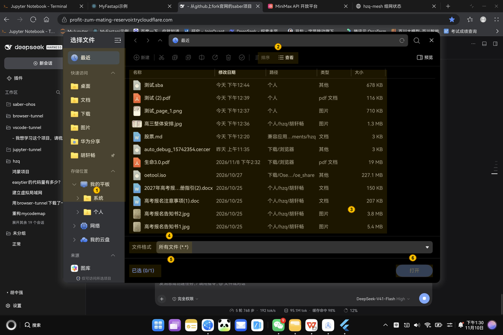

| # | 说明 |
|---|---|
| 1 | **位置栏**。左边一竖排,可以在「快速访问 / 存储位置 / 网络」之间切换,快速跳到常用目录 |
| 2 | **排序 / 查看**。可以按修改时间排序,也能切换成大图标视图 |
| 3 | **文件列表**。带「路径」「类型」「大小」三列,一眼能看出文件是什么、在哪儿 |
| 4 | **文件格式**。默认是「所有文件」,点开可以只显示某一种格式 |
| 5 | **已选**。显示当前选中了几个文件(`0/1` 表示最多选 1 个) |
| 6 | **打开**。确认导入选中的文件 |

> **能导入什么**:只有 `.sba`(Saber 笔记文件,一般在「文档」或你导出时选的目录里)。
> 选到别的格式(比如 `.md`、`.jpg`)会提示「格式无效」,直接选一个 `.sba` 就行。
>
> **导入 PDF 暂时不行**:鸿蒙版没有内置 PDF 渲染引擎,所以编辑器里不会出现「导入 PDF」按钮。
> 这是有意隐藏的,不是坏了 —— 参见 [第十节](#十鸿蒙上的已知限制重要)。

---

## 四、笔记编辑器:手写

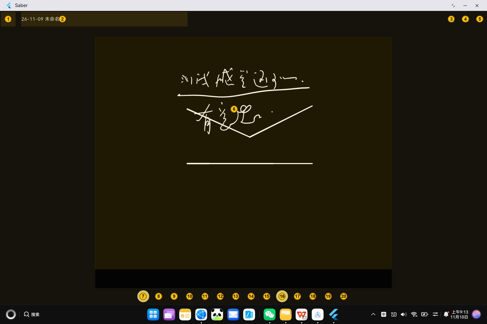

### 4.1 顶部工具栏

| # | 说明 |
|---|---|
| 1 | **保存状态指示器**。空心圆 = 已保存 / 实心转圈 = 正在保存 / 有实心点 = 有未保存改动。点它可以**立即保存** |
| 2 | **笔记标题**。直接点就能改名字 |
| 3 | **插入页面**。在当前页后面插一张新纸 |
| 4 | **页面管理**。弹出对话框可以查看、切换、删除、调整页面顺序 |
| 5 | **更多(⋮)**。打开编辑器设置(背景纸样、行距、线宽等),见 [4.6](#46-编辑器设置) |

### 4.2 画布与手势

| # | 说明 |
|---|---|
| 6 | **画布**。手写区域。白色/浅色底是纸,深色是墨迹 |

画布支持以下手势:

| 手势 | 作用 |
|---|---|
| 笔尖划过 | 书写(永远有效,不受设置影响) |
| **手指拖动** | **平移画布**(默认)。打开「手指绘制」后变成书写 |
| 双指捏合 | 缩放画布 |
| 双指拖动 | 平移画布 |

在画布左上角还会出现三个小按钮(缩放锁定 / 单指平移锁定 / 轴对齐平移锁定),
它们只在画布被操作后短暂显示,用来把画布「钉住」防止误触。

### 4.3 底部工具栏:14 个按钮

| # | 按钮 | 说明 |
|---|---|---|
| 7 | **钢笔** | 压感笔,最常用的工具 |
| 8 | **铅笔** | 素描笔,笔触有颗粒感 |
| 9 | **荧光笔** | 半透明马克笔,适合划重点 |
| 10 | **颜色** | 打开调色板,见 [4.4](#44-颜色选择) |
| 11 | **选择** | 圈选一段笔迹,可以整体移动、改颜色、删除 |
| 12 | **激光笔** | 演示用的高亮光点,不会留在纸上 |
| 13 | **橡皮擦** | 再点一次切换回上一个工具 |
| 14 | **照片** | 插入图片。✅ **鸿蒙上可用**,见 [4.7](#47-插入照片) |
| 15 | **文本** | 切换成文字编辑模式,可以用键盘打字 |
| 16 | **手指绘制** | ⭐ **鸿蒙用户必看**:打开后手指可以直接书写;关闭时手指只用于平移画布 |
| 17 | **全屏** | 隐藏所有界面元素,只留纸面 |
| 18 | **撤销** | 撤销上一步。没有可撤销时是灰的 |
| 19 | **重做** | 重做。无内容时是灰的 |
| 20 | **导出** | 导出为 SBA / PDF / PNG,见 [4.5](#45-导出) |

> **关于第 16 项「手指绘制」**
> Saber 把「手指」默认当成平移画布的手势,把「笔」当成书写工具 —— 这是为了
> 避免手掌/小指误触留下墨迹。但在没有手写笔的平板上,手指才是主力输入。
> 所以第一次用平板时,请**先点一下这个按钮**(它会高亮)。
> 这个设置会记住,不用每次都开。

### 4.4 颜色选择

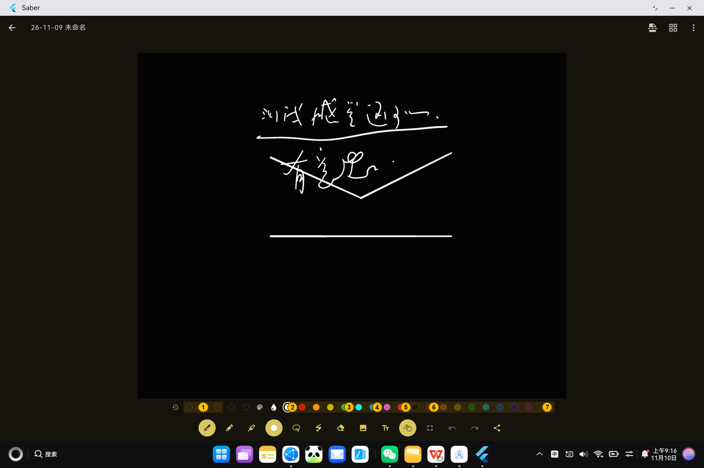

| # | 说明 |
|---|---|
| 1 | **最近使用的颜色**。左边这 5 个格子是你最近用过的颜色(数量可在设置里调) |
| 2 | **白色** |
| 3 | **黄色** |
| 4 | **青色** |
| 5 | **紫色** |
| 6 | **黑色** |
| 7 | **深红 / 酒红** |

调色板一共 19 个标准色,从左到右依次是:
白、红、橙、黄、绿、青、蓝、紫、粉、黑,以及暗红、棕、橄榄、深绿、茶青、藏蓝、深紫、酒红。

在深色主题下画布是纯黑的,**请避免用黑色墨迹**,否则看不见。

### 4.5 导出

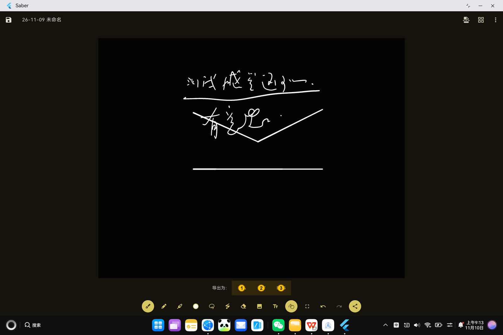

| # | 格式 | 说明 |
|---|---|---|
| 1 | **SBA** | Saber 自己的笔记格式,包含全部页面、笔迹和设置,可以用 Saber 重新打开 |
| 2 | **PDF** | 分页 PDF,适合打印 |
| 3 | **PNG** | 当前页导出成图片 |

> ✅ **鸿蒙上这三个格式都能正常导出。**
> 点完之后会弹出**鸿蒙自带的「另存为」对话框**,选好位置、点「保存」就存到磁盘上了。
> 鸿蒙上不提供「分享到其它应用」,所以走的是「另存为」这条路 ——
> 工具栏上那个按钮的图标在鸿蒙上是一个**向下箭头**(别处是「分享」图标),
> 它只会「另存为」,不会弹分享面板。

#### 另存为对话框

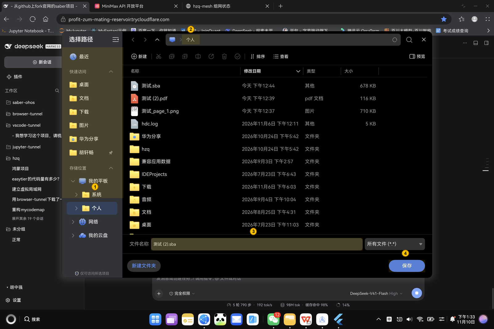

| # | 说明 |
|---|---|
| 1 | **当前位置**。默认是「个人」目录,可以在左边竖排里换到别的目录 |
| 2 | **文件名**。默认用笔记标题 + 扩展名,可以改 |
| 3 | **保存**。点下去文件就写到当前位置了 |
| 4 | 如果那个位置已经有同名文件,系统会再问一次「替换 / 取消」 |

> **PNG 一次只导出当前页**,而且是按页命名的(比如 `测试_page_1.png`)。
> 想要整篇笔记的图片,还是导 **PDF** 更省事。

### 4.6 编辑器设置

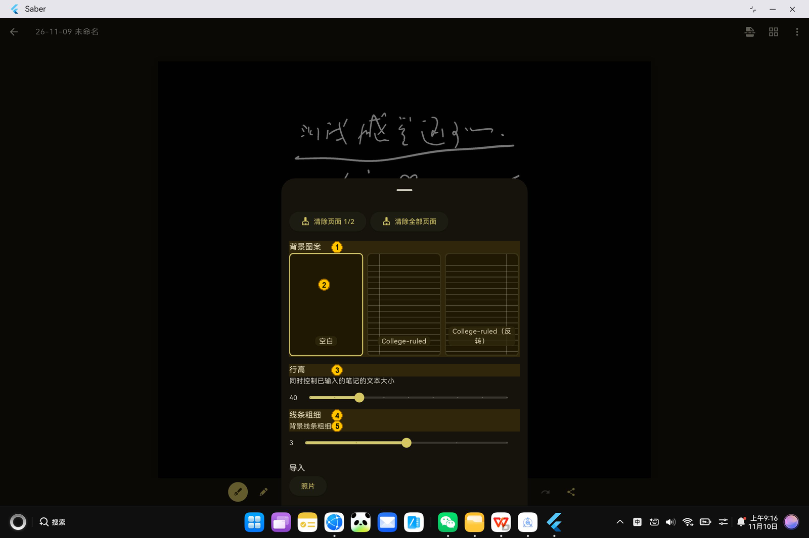

| # | 说明 |
|---|---|
| 1 | **背景图案**。选择纸的样式 |
| 2 | 三种样式:**空白** / **College-ruled**(横格) / **College-ruled(反转)** |
| 3 | **行高**。同时控制已输入文字的大小 |
| 4 | **线条粗细** |
| 5 | **背景线条粗细**。只影响格子线的粗细,不影响笔迹 |

### 4.7 插入照片

工具栏上的 **「照片」** 按钮(从左往右第 8 个图标,📷)可以往画布里插图片。

1. 点 **「照片」**。
2. 弹出**鸿蒙自带的文件选择器**,而且**已经帮你过滤好了**,只显示能插入的格式:
   `.jpg` `.jpeg` `.png` `.gif` `.tiff` `.bmp` `.tga` `.ico` `.pvrtc` `.svg` `.webp` `.psd` `.exr`。
3. 选一个文件,点 **「打开」**,图片就贴到画布上了。

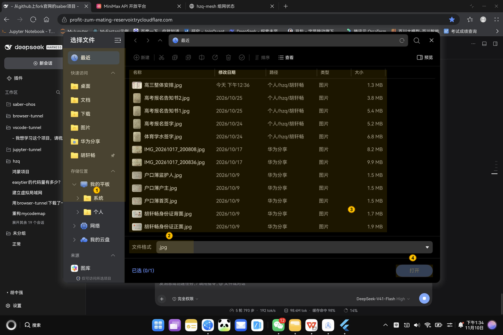

| # | 说明 |
|---|---|
| 1 | **位置栏**。照片一般在「图片」或「个人」目录里 |
| 2 | **文件格式**。这里已经自动填好了 `.jpg` 之类的过滤条件,**不用手动改** |
| 3 | **文件列表**。因为加了过滤,列表里只会出现能插入的图片,不会出现 PDF / 压缩包之类的文件 |
| 4 | **打开**。确认插入 |

> 插入进来的图片会**按原大小放在画布中间**,可以用「选择」工具拖动位置。
> 太大的图片会被压缩 —— 压缩阈值在「设置 → 性能 → 最大图片大小」里调。

---

## 五、白板

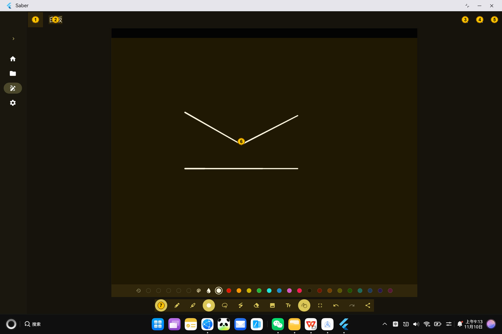

| # | 说明 |
|---|---|
| 1 | 保存状态指示器(同编辑器) |
| 2 | 标题「白板」—— **不能改名**,它固定存放在 `/_whiteboard` |
| 3 | 插入页面 |
| 4 | 页面管理 |
| 5 | 更多设置(⋮) |
| 6 | **画布**。白板是**临时的**草稿区,不会出现在笔记列表里 |
| 7 | 底部工具栏,和笔记编辑器完全一样 |

**白板和普通笔记的区别:**

- 白板是**一个固定的临时页面**,适合开会时随手画;
- 离开应用时白板**会被清空**(可在「设置 → 书写 → 离开应用后清除白板」里关掉);
- 白板**不会**出现在「全部笔记」里。

---

## 六、全部笔记(浏览)

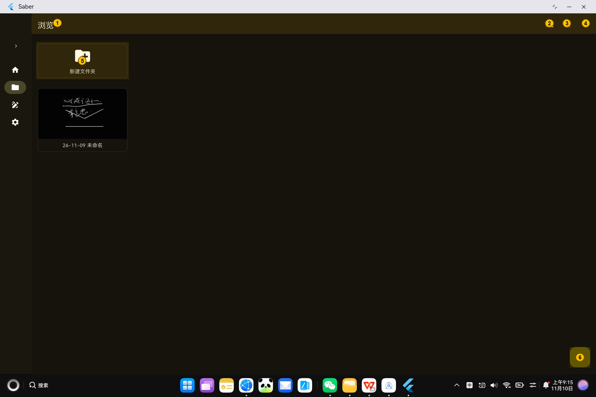

| # | 说明 |
|---|---|
| 1 | 标题「浏览」 |
| 2 | **排序**。按名称 / 时间排序 |
| 3 | **布局切换**(同首页) |
| 4 | **同步状态** |
| 5 | **新建文件夹**。点它建一个新的文件夹来归类笔记 |
| 6 | `＋` 按钮,同首页 |

「浏览」页会显示完整的目录结构,点文件夹可以逐层进入。
顶部会有一条**面包屑导航**,点前面的层级可以跳回上级目录。

---

## 七、文件树

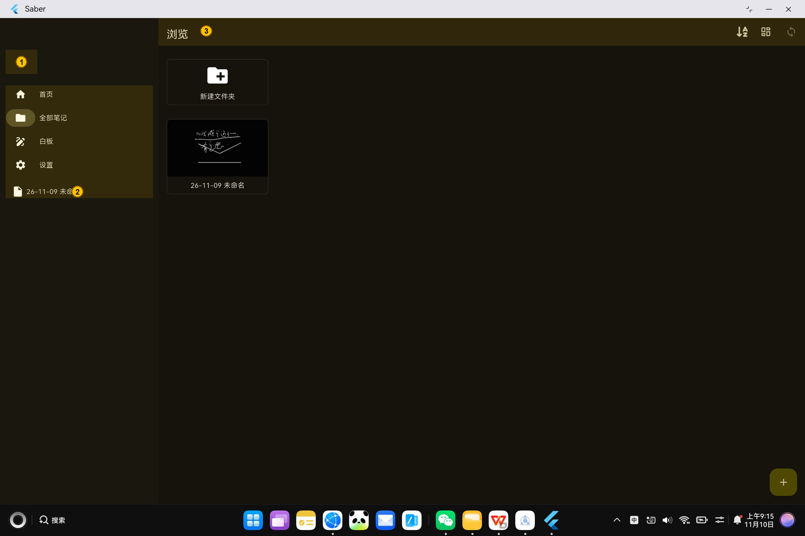

| # | 说明 |
|---|---|
| 1 | 点这个按钮把侧边栏**收回去** |
| 2 | 展开后的侧边栏下半部分就是**文件树**,笔记和文件夹按层级列出,当前所在的路径会高亮 |
| 3 | 展开后,主内容区会自动往右让出位置 |

文件树适合笔记很多的时候 —— 不用来回切页面,直接在树里点。

---

## 八、设置

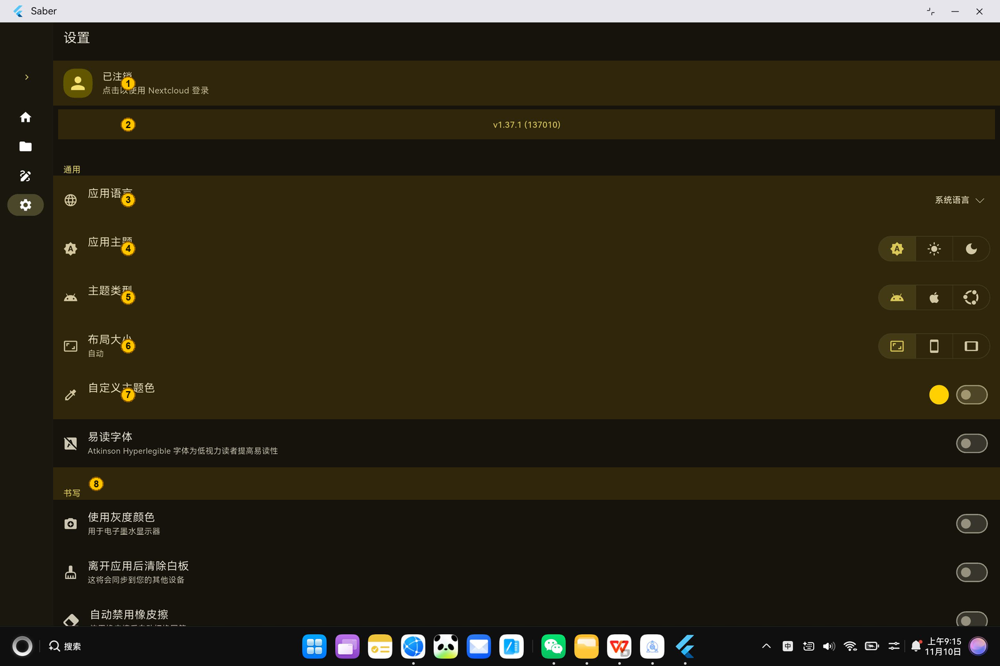

| # | 设置项 | 说明 |
|---|---|---|
| 1 | **Nextcloud 登录** | 未登录时显示「已注销」,点一下进入登录页,见 [第九节](#九nextcloud-同步) |
| 2 | **版本号** | 点它会检查更新 |
| 3 | **应用语言** | 跟随系统,或手动指定 |
| 4 | **应用主题** | `系统` / `浅色` / `深色` |
| 5 | **主题类型** | `Material`(Material Design 3) / `Cupertino`(iOS 风格) / `Yaru`(Ubuntu 风格) |
| 6 | **布局大小** | `自动` / `手机` / `平板`。**鸿蒙平板建议选「平板」**,界面更宽,能用上左右分栏 |
| 7 | **自定义主题色** | 挑一个你喜欢的强调色 |
| 8 | **「书写」分组** | 下面接着是书写相关的设置 |

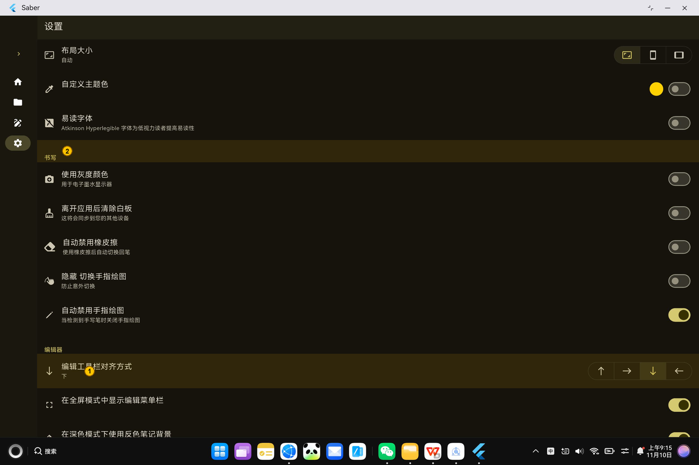

| # | 设置项 | 说明 |
|---|---|---|
| 1 | **编辑工具栏对齐方式** | 工具栏放在画布的 `上` / `右` / `下` / `左`。**默认是「下」** —— 竖屏时把工具栏挪到右边或左边更顺手 |
| 2 | **「书写」分组** | 笔迹相关的设置都在这一组 |

### 「书写」分组

这一组全是**开关**,都在「设置 → 书写」下面:

| 设置项 | 说明 |
|---|---|
| **使用灰度颜色** | 用于电子墨水显示器。普通屏幕不用开 |
| **离开应用后清除白板** | 关掉之后白板内容会被同步到你的其他设备 |
| **自动禁用橡皮擦** | 用完橡皮擦后自动切回笔,省得再点一次 |
| **隐藏 切换手指绘图** | ⚠️ **开了就找不到「手指绘制」按钮了**。鸿蒙平板请保持关闭 |
| **自动禁用手指绘图** | 检测到手写笔时自动关掉手指绘图。**没有笔就别开** |

> **「隐藏 切换手指绘图」这一项要留意**
> 它会把编辑器底部工具栏上的「手指绘制」按钮整个隐藏掉。
> 如果不小心打开了这个开关,手指绘图就只能去别处开 —— 把这一项关掉,
> 按钮就会重新出现。

### 「编辑器」分组

| 设置项 | 说明 |
|---|---|
| **编辑工具栏对齐方式** | 工具栏放在画布的 `上` / `右` / `下` / `左`。**默认是「下」** —— 竖屏时把工具栏挪到右边或左边更顺手 |

### 「性能」分组

| 设置项 | 说明 |
|---|---|
| **最大图片大小** | 插入的图片超过这个尺寸(500 / 1000 / 2000 像素)会被压缩。平板建议调大 |
| **自动保存** | `5s` / `10s` / `禁用`。停笔后延迟这么久自动存一次 |
| **形状识别延迟** | 画完一个圆/直线后,Saber 会自动把它「规整」成规整图形。这个值是规整前的等待时间,`禁用` 表示不做规整 |

### 「高级」分组

鸿蒙平板上这一组是下面这些:

| 设置项 | 说明 |
|---|---|
| **错误报告** | 崩溃自动上报。可以关掉,关掉之后应用不会往外发任何东西 |
| **自动检查 Saber 更新** | 启动时检查有没有新版本 |
| **更快的更新提醒** | 有新版本时尽快告诉你(需要联网) |
| **允许不安全的连接** | 连自签证书的服务器(Nextcloud 自建常用)。**不建议开** |
| **查看日志** | 把调试日志导出来,反馈问题的时候很有用 |

> Android 上还有一个「自定义 Saber 文件夹」,鸿蒙版**没有**这一项 ——
> 原因见 [第十节](#十鸿蒙上的已知限制重要) 的说明。
> 同理,「打开 Saber 文件夹」这个按钮在鸿蒙上也没有(笔记在应用沙箱里,
> 系统文件管理器看不到)。

---

## 九、Nextcloud 同步

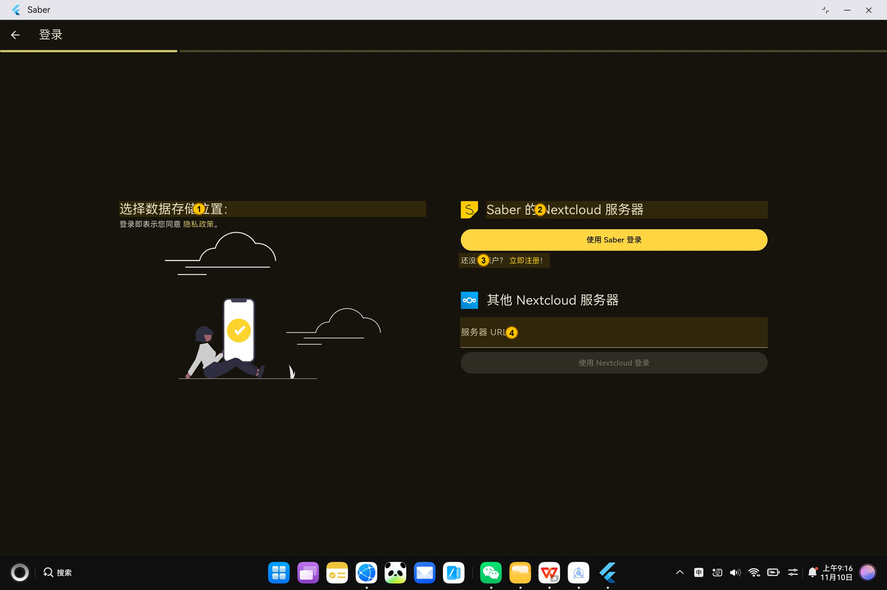

| # | 说明 |
|---|---|
| 1 | **选择数据存储位置**。Saber 的笔记既可以存在本地,也可以存在你的 Nextcloud 上 |
| 2 | **Saber 的 Nextcloud 服务器**。点它用官方服务器登录 |
| 3 | **还没有帐户?** 可以去注册一个 |
| 4 | **其他 Nextcloud 服务器**。自建 Nextcloud 的话,在下面填服务器 URL |

登录成功后,首页标题栏右侧的同步按钮会变成可点击状态:

- 点它 = **立即同步一次**;
- 同步中按钮上会显示进度;
- 同步完成后首页的笔记列表会刷新。

> Nextcloud 同步走的是标准的 WebDAV 接口,鸿蒙上**可以正常工作**。

> **鸿蒙上的登录方式**:点「登录」会弹出**系统自带浏览器**(不是应用内嵌窗口),
> 在浏览器里完成 Nextcloud 账号登录即可。应用本身不保存账号密码,
> 每秒轮询一次服务器拿登录凭证,所以浏览器里登录完回到 Saber 就自动生效了。
>
> ⚠️ 这一点我们**没有真实的 Nextcloud 服务器可以端到端验证**,只验证到
> 「链接能交给系统浏览器打开」这一层(用的是「关于 → 隐私政策」那个链接做的验证)。
> 如果你在鸿蒙上登录时卡住了,请告诉我们。

---

## 十、鸿蒙上的已知限制(重要)

下面是这套鸿蒙适配**当前的实际状态**。

### 已经打通的

| 功能 | 状态 | 说明 |
|---|---|---|
| **导入笔记**(`.sba`) | ✅ 正常 | 用鸿蒙系统自带的文件选择器,见 [3.1](#31-导入笔记的步骤) |
| **插入照片** | ✅ 正常 | 选择器已经按支持的图片格式过滤好了,见 [4.7](#47-插入照片) |
| **导出保存**(SBA / PDF / PNG) | ✅ 正常 | 走鸿蒙的「另存为」对话框,见 [4.5](#45-导出) |
| 手写、绘图、分页、选择、撤销重做 | ✅ 正常 | |
| 文本输入 | ✅ 正常 | |
| 背景纸样、行距、线宽 | ✅ 正常 | |
| 保存 / 自动保存 | ✅ 正常 | |
| 文件夹管理、浏览、文件树 | ✅ 正常 | |
| 设置里的所有选项 | ✅ 正常 | |
| **Nextcloud 同步** | ✅ 正常 | |
| 保存图片到系统相册 | ✅ 正常 | `saver_gallery` 已支持鸿蒙 |

### 用不了的(按钮已经被藏起来了)

| 功能 | 原因 | 说明 |
|---|---|---|
| **导入 PDF** | 鸿蒙上没有 PDF 渲染引擎(`pdfrx` / `pdfium` 的原生库缺失) | 编辑器里**不会出现**「导入 PDF」按钮,不是点了没反应 |
| **自定义数据目录**(把笔记放到别的文件夹) | 鸿蒙的系统文件选择器**没有「持久化授权」**,授权只在本次会话内有效 | 设置里**不会出现**「自定义 Saber 文件夹」,笔记固定存在应用沙箱里。详见下方说明 |
| **分享到其它应用** | `share_plus` 没有鸿蒙实现 | 鸿蒙版不走分享,改走「另存为」;导出栏里只有 SBA / PDF / PNG,没有「分享」这一项,工具栏按钮的图标也换成了向下箭头 |
| **后台同步**(息屏后还继续同步) | 鸿蒙没有 WorkManager 对应机制 | 同步只在应用**前台**进行;界面上的开关本来就没做,所以鸿蒙上根本看不到 |

> 这几项都是**主动隐藏**的,不会让用户点了没反应。
> 想要 PDF 的话:先用别的工具把 PDF 转成图片,再用「照片」按钮插进来。

### 为什么「自定义数据目录」在鸿蒙上做不了

这一条值得展开说,因为它在 Android 上明明是能用的,鸿蒙上却不行:

| | Android | 鸿蒙 |
|---|---|---|
| 用的机制 | SAF(存储访问框架) | `DocumentViewPicker` |
| 授权能持久化吗 | **能**(`grant: .lifetime` + `persistGrant: true`) | **不能** —— 鸿蒙的文件接口里根本没有「持久化 URI 授权」这个 API |
| 后果 | 重启之后还能读写那个目录 | **重启之后就再也读不到了** |

实测(MatePad Edge / HarmonyOS 7.0.0):在设置里选一个外部文件夹,笔记会被搬过去,
当次使用完全正常;但把应用杀掉再启动,所有笔记立刻变成

```
PathAccessException: Cannot open file,
path = '/storage/Users/currentUser/Documents/...'
```

连设置里那个入口都会点不开 —— 因为判断目录是否存在的那一行自己就会抛异常。

所以鸿蒙版**主动隐藏**了这个入口:笔记放在应用沙箱里,不会因为一次误操作
就再也打不开。

> 顺带一提:万一真的出现「笔记全都打不开」(比如换了设备、系统升级改了沙箱路径),
> 现在也不会整个应用都废掉 —— 应用启动时会自己检查一次,发现目录读不到就自动
> 退回沙箱目录并记一条日志,不会满屏红色报错。

### 需要手动设置

| 事项 | 说明 |
|---|---|
| **打开「手指绘制」** | 见 [4.3](#43-底部工具栏14-个按钮) 第 16 项。**不打开的话手指拖动只会平移画布,写不出字** |

### 建议

| 事项 | 说明 |
|---|---|
| 布局大小选「平板」 | 默认的「自动」在竖屏时按手机布局显示,按钮会挤在一起 |
| 避免用黑色墨迹 | 深色主题下画布是纯黑的 |
| 工具栏对齐方式 | 竖屏时改成「左」或「右」更顺手 |
| 导出的文件放哪儿 | 「另存为」默认落在系统的「个人」目录,找文件时去「文件 → 个人」找 |

---

## 十一、故障排除

| 现象 | 原因 | 怎么办 |
|---|---|---|
| **手指划不出笔迹** | 手指绘制没打开 | 点底部工具栏的「手指绘制」按钮 |
| 找不到「手指绘制」按钮 | 设置里开了「隐藏 切换手指绘图」 | 「设置 → 书写」→ 关掉「隐藏 切换手指绘图」 |
| 一划就变成整页平移 | 同上 | 同上 |
| 笔迹看不见 | 用了黑色墨迹 | 打开调色板换颜色 |
| 「＋」→「导入笔记」提示格式无效 | 选的不是 `.sba` 文件 | 换成一个 `.sba` 再试 |
| 导出后找不到文件 | 存到了系统的「个人」目录 | 打开「文件」App → 「个人」 |
| 另存为时提示「替换」 | 目标位置已经有同名文件 | 确认覆盖,或改个文件名 |
| 标题栏的同步按钮是灰的 | 没登录 Nextcloud | 去「设置」→ 点最上面的 Nextcloud 区域登录 |
| 顶部小圆点一直转 | 正在保存 | 稍等;点一下圆点可以强制立即保存 |
| 笔记没出现在首页 | 首页只显示**最近编辑**的笔记 | 去「全部笔记」看完整列表,或展开左侧文件树 |
| 界面挤在一起 / 按钮很小 | 布局被识别成手机尺寸 | 「设置」→「布局大小」→ 选「平板」 |
| 应用启动后白屏 | 安装的是 debug 包(AOT 未生效) | 重新安装 release 包,见构建文档 |
| 手写很卡 | 同上,debug 包每 100ms 一次 JANK | 同上 |

---

## 附:这套适配是怎么来的

如果你想自己重新构建这份鸿蒙版,或者想把它合并回上游:

| 文档 | 内容 |
|---|---|
| [`saber/harmony/docs/ohos.md`](../ohos.md) | 完整的构建、签名、部署指南 |
| [`saber/harmony/toolchain/README.md`](../../toolchain/README.md) | 工具链说明(每个脚本干什么) |
| [`saber/harmony/docs/ohos-upstream.md`](../ohos-upstream.md) | 合并回上游的拆分策略与操作手册 |

**导入 / 导出 / 插照片** 这三项能力来自我们补写的鸿蒙插件:

| 位置 | 说明 |
|---|---|
| [`saber/harmony/packages/file_picker_ohos/`](../../packages/file_picker_ohos/) | `file_picker` 的鸿蒙实现。Dart 侧实现 `FilePickerPlatform`,原生侧直接用鸿蒙的 `DocumentViewPicker` / `PhotoViewPicker`,选完把文件复制进应用沙箱再交给 Dart |
| [`saber/harmony/packages/file_picker_ohos/ohos/src/main/ets/components/plugin/FilePickerDelegate.ets`](../../packages/file_picker_ohos/ohos/src/main/ets/components/plugin/FilePickerDelegate.ets) | 选文件 / 选目录 / 另存为的具体逻辑 |

> 关键点:它是以 **federated plugin**(`implements: file_picker`)的形式提供的,
> 并且**必须写进 `pubspec.yaml` 的 `dependencies`** —— 只写在 `dependency_overrides`
> 里的话,`flutter_tools` 发现不了它,插件不会被注册。

**本手册中所有截图的生成方式**(可复现):

```bash
# 1. 连上设备
hdc tconn <设备IP>:<无线调试端口>

# 2. 抓语义树(元素文本 + 精确坐标)
python harmony/docs/manual/tools/hui.py dump --bundle com.sabernotes.saber --all
#    设备端的 -b 过滤对 Flutter 窗口会返回空树,脚本会自动回退成
#    "整屏 dump + 按窗口过滤";想自己看有哪些窗口就跑:
#    python harmony/docs/manual/tools/hui.py windows

# 3. 截图 + 打标注
python harmony/docs/manual/tools/hui.py shot shots/01-home.jpeg
python harmony/docs/manual/tools/make_manual_images.py     # Windows / macOS
# bash harmony/docs/manual/tools/make_manual_images.sh      # Linux
```

> **前提**:第 2 步要拿到 Flutter 的语义树,设备上必须**启用无障碍服务**
> (设置 → 辅助功能 → 无障碍,启用任意一个即可,例如屏幕朗读)。
> Flutter 只有在检测到无障碍客户端时才会构建语义树,否则
> `uitest dumpLayout` 只能看到一个空壳的 `XComponent`。
> 第 3 步(截图 + 打标注)不依赖这个前提。

> 标注的坐标全部写在 `harmony/docs/manual/tools/make_manual_images.sh` 里(每张图一组 `--ann`)。
> `harmony/docs/manual/tools/make_manual_images.py` 会**直接解析那个 shell 脚本**再逐条调用
> `scripts/annotate.py`,所以 Windows 上不需要 bash,也不会出现"两份坐标抄错"的问题。
